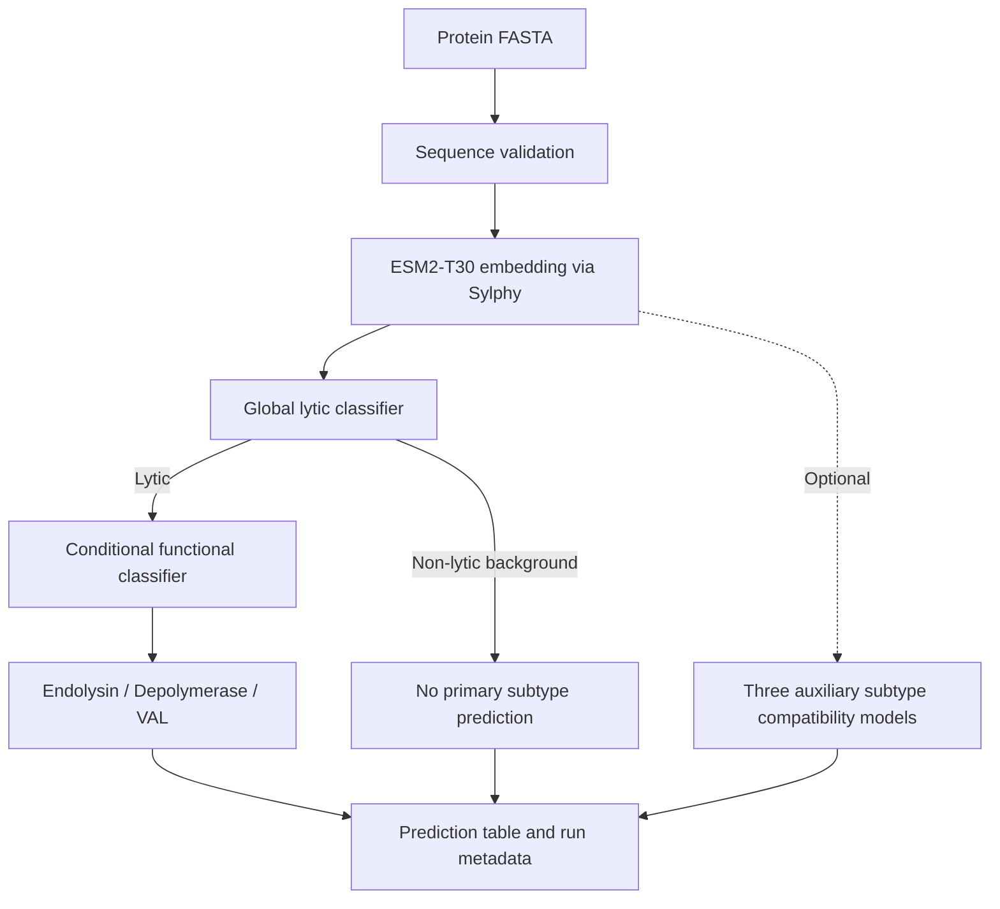
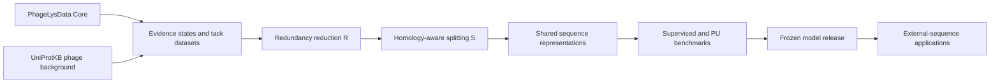

# PhageLysClass

**Evidence-aware machine learning for recognizing phage lytic enzymes from protein sequences**

PhageLysClass is a computational framework for studying and predicting phage-associated lytic protein functions. It combines curated biological evidence, explicit definitions of negative and unlabeled proteins, sequence redundancy control, homology-aware evaluation, numerical protein representations, and supervised and positive–unlabeled (PU) learning.

This repository provides the **research source code, selected analytical notebooks, frozen PhageLysClass v1 models, and an executable FASTA prediction interface**. It is intended both for researchers interested in the methodological study and for users who want to score their own protein sequences without training a model.

> **Release scope:** This is a compact code-and-model release. It does not include the complete raw/processed datasets, full embedding matrices, or all factorial training outputs. The frozen production models can be used independently of the original training workflow, provided the model bundle and compatible dependencies are available.

**[Get started](#quick-start) · [Use the models](#predict-from-a-fasta-file) · [Explore the workflow](#scientific-workflow) · [Read the documentation](#documentation) · [Understand the limitations](#scope-and-interpretation)**

---

## What PhageLysClass does

The framework addresses two related questions:

1. **Global recognition:** Is a protein sequence compatible with the phage lytic-enzyme class or with the modeled non-lytic phage-protein background?
2. **Conditional functional assignment:** If classified as lytic, is it most compatible with an **endolysin**, **depolymerase**, or **virion-associated lytic enzyme (VAL)**?

The research workflow also examines how these predictions depend on the quality of biological evidence and the design of the machine-learning experiment.

| Capability | What is included |
| --- | --- |
| Evidence-aware task construction | Curated positive sequences, evidence-defined negative candidates, unlabeled proteins, and separate ambiguous/challenge sets |
| Sequence-relatedness controls | BioSieve/MMseqs2 redundancy reduction and homology-aware splitting |
| Numerical representations | Roxy descriptors, Sylphy one-hot encoding, and protein language model embeddings |
| Learning strategies | Supervised binary/multiclass modeling and PU-learning benchmarks |
| Model release | Frozen `phagelysclass_v1` estimators, model metadata, manifest, and checksums |
| Inference | FASTA input, global prediction, gated functional assignment, and optional subtype compatibility scores |
| External applications | Prepared examples and research code for prediction-extension, ZymCTRL-generated, and structurally ambiguous sequences |

## Quick start

### 1. Create the Conda environment

The repository uses a single Conda environment specification, including **MMseqs2 from Bioconda** and the Python packages used for the research workflow and inference.

```bash
conda env create -f environment.yml
conda activate phagelysclass
```

The file pins the Python and selected package versions recorded in the frozen model manifest; other dependencies are declared without an unsupported historical version claim. **The environment has not been freshly installed or solver-tested as part of this release preparation.** GPU execution also depends on an appropriate PyTorch/CUDA configuration for the host system.

### 2. Check the frozen model bundle

The model directory should contain its manifest and task artifacts:

```text
models/phagelysclass_v1/
├── manifest.json
├── checksums.tsv
├── representation/
│   └── esm2_t30_150m.json
└── tasks/
    ├── global_mixed/
    ├── multiclass_clean/
    ├── subtype_endolysin/
    ├── subtype_depolymerase/
    └── subtype_val/
```

Each task stores fitted model members under `members/` and task-specific metadata. Do not modify the model files or their declared representation contract. Large serialized estimators may require separate large-file hosting when this working folder is published on GitHub.

### 3. Predict from a FASTA file

Run the command from the repository root:

```bash
python inference/phagelysclass_predict.py \
  --input examples/known_positive_depolymerase_demo.fasta \
  --models models/phagelysclass_v1 \
  --output example_predictions.tsv \
  --auxiliary
```

The predictor writes `example_predictions.tsv` and the automatically generated sidecar `example_predictions.tsv.metadata.json`. To analyze a different sequence collection, replace the value passed to `--input` with your own protein FASTA file.

Optional controls include `--device auto|cpu|cuda`, `--batch-size`, and `--metadata-output`. Outputs can be `.tsv` or `.csv`. Omit `--auxiliary` when only the default two-core prediction is needed.

**Input expectations:** FASTA identifiers must be unique; protein sequences must use the 20 canonical amino acids and contain at most 1,024 residues. Invalid sequences are reported with an input status and warnings rather than receiving ordinary predictions.

## How the production predictor works



The released model is identified by `models/phagelysclass_v1/manifest.json` and uses **ESM2-T30** (`facebook/esm2_t30_150m_ur50d`) through Sylphy, with a last-layer, mean-pooled, FP32 sequence representation of **640 features**.

| Model component | Frozen estimators | Use |
| --- | --- | --- |
| Global core (`global_mixed`) | KNN + MLP | Lytic versus modeled non-lytic background |
| Functional core (`multiclass_clean`) | XGBoost + Logistic Regression | Endolysin, Depolymerase, or VAL when the global prediction is lytic |
| Endolysin auxiliary | KNN + XGBoost + MLP | Optional subtype compatibility score |
| Depolymerase auxiliary | MLP + KNN | Optional subtype compatibility score |
| VAL auxiliary | MLP | Optional subtype compatibility score |

The bundle comprises **five components and ten fitted estimators**. The core prediction uses four estimators by default; auxiliary models are independent diagnostics. The frozen architecture and software metadata are recorded in the manifest.

### Reading the prediction table

| Column | Interpretation |
| --- | --- |
| `global_score` | Score used by the global core; the released decision threshold is 0.5 |
| `global_prediction` | `lytic` or `non_lytic_background` |
| `p_endolysin_given_lytic` | Conditional endolysin probability, only for globally lytic predictions |
| `p_depolymerase_given_lytic` | Conditional depolymerase probability, only for globally lytic predictions |
| `p_val_given_lytic` | Conditional VAL probability, only for globally lytic predictions |
| `functional_prediction` | Most compatible subtype when the global gate is positive |
| `*_compatibility_score` | Optional subtype-specific diagnostic scores, enabled by `--auxiliary` |
| `input_status`, `warnings` | Sequence validation and relevant interpretation warnings |

The three `p_*_given_lytic` values are **not unconditional biological probabilities**. They are emitted only if the global model predicts `lytic`; they are absent for globally non-lytic predictions. Auxiliary scores do not override the hierarchical prediction. A computational prediction alone does not establish enzymatic activity, substrate specificity, or experimental functionality.

The included five-sequence depolymerase FASTA is a **positive-control example from the project's evidence universe**, not an independent external-validation dataset. See [Model and inference](docs/MODEL_AND_INFERENCE.md) and the [inference reference](inference/README.md) for details.

---

## Scientific workflow

PhageLysClass uses **PhageLysData v1.0** as the curated source of positive lytic-enzyme evidence and a taxonomy-defined **UniProtKB** phage-protein background. A central principle is that *the absence of an annotation is not evidence of biological inactivity*. Consequently, known positives (**P**), evidence-defined negative candidates (**N**), and unlabeled proteins (**U**) remain conceptually distinct.



| Stage | Location | Scientific purpose |
| --- | --- | --- |
| 01–05 | [`src/dataset_processing/`](src/dataset_processing/) | Extract positives, retrieve/audit the background, and construct P/N/U evidence-state universes |
| 06 | [`src/task_definitions/`](src/task_definitions/) | Define global, subtype, multiclass, PU, and challenge tasks |
| 07 | [`src/redundancy/`](src/redundancy/) | Apply independent BioSieve/MMseqs2 reduction regimes within biological strata |
| 08 | [`src/splitting/`](src/splitting/) | Build homology-aware outer train/test splits |
| 09 | [`src/reporting/`](src/reporting/) | Summarize dataset flow and splitting characteristics |
| 10A–10E | [`src/representations/`](src/representations/) | Build a shared sequence universe, compute descriptors/embeddings, and freeze predictive eligibility |
| 10F–11 | [`src/training/`](src/training/) | Freeze inner group-aware validation and fit supervised/PU benchmark models |
| 12 | [`src/analysis/`](src/analysis/) | Aggregate and audit benchmark outputs |
| RQ analyses | [`notebooks/`](notebooks/) | Inspect evidence definition, representation, algorithms, robustness, uncertainty, and model selection |
| EDA | [`eda/`](eda/) | Characterize sequence populations, descriptors, and representation geometry |
| A0–A4 | [`external_application/`](external_application/) | Compare external-sequence predictions with physicochemical and reference-space evidence |

### Redundancy and homology are separate experimental factors

The benchmark evaluates four redundancy regimes (`R90`, `R70`, `R50`, `R30`) and four homology-aware splitting regimes (`S90`, `S70`, `S50`, `S30`) in a **4 × 4 factorial design**. The supervised branch considers predefined classical ML learners and four primary representation families; the PU branch compares different ways of learning from known positives and unlabeled sequences.

This design supports analysis of how changing evidence definitions, sequence similarity and representation choices affects model evaluation. PU scores against observed P/U labels must be interpreted as **observed-label diagnostics**, not as performance against confirmed biological negatives.


The methodological details and the retained research notebooks are explained in [Scientific workflow](docs/WORKFLOW.md) and [Benchmarking and analysis](docs/BENCHMARKING_AND_ANALYSIS.md).

## Repository structure

```text
phagelysclass/
├── src/                   # Numbered scientific pipeline scripts
│   ├── dataset_processing/
│   ├── task_definitions/
│   ├── redundancy/
│   ├── splitting/
│   ├── reporting/
│   ├── representations/
│   ├── training/
│   └── analysis/
├── config/                # Evidence rules, taxonomy queries, representation registry
├── runs/                  # Original supervised and PU execution scripts
├── notebooks/             # Selected RQ and model-release notebooks
├── eda/                   # E0–E6 exploratory analysis and figure builder
├── external_application/  # External prediction and characterization scripts
├── inference/             # Standalone FASTA predictor
├── models/                # Frozen PhageLysClass v1 artifacts
├── examples/              # Positive control and prepared sequence collections
├── figures/               # Selected publication figure assets
├── docs/                  # Scientific and technical documentation
├── environment.yml        # Conda/Bioconda and Python dependencies
├── LICENSE
└── README.md
```

The numbered scripts preserve the methodological stages and their original I/O contracts. The source files have **not** been rewritten to change their default input paths during release organization.

## External-sequence examples

The repository includes prepared material for three complementary applications:

| Collection | Location | Scientific use |
| --- | --- | --- |
| PhageLysData prediction extension | [`examples/phagelys_prediction_extension/`](examples/phagelys_prediction_extension/) | Explore predictions in a redundancy-reduced extension cohort |
| ZymCTRL-generated sequences | [`examples/zymctrl_generated/`](examples/zymctrl_generated/) | Explore catalytic-condition-generated sequence space |
| Structurally ambiguous phage proteins | [`examples/ambiguous_structural/`](examples/ambiguous_structural/) | Study predictions for incompletely resolved phage structural proteins |

The `external_application/` scripts retain the original integration (A0), prediction landscape (A1), physicochemical comparison (A2), reference-space geometry (A3), and concordance integration (A4) analyses. These are **computational consistency analyses**, not experimental confirmation of lytic activity. For their inputs and interpretation, see [External applications](docs/EXTERNAL_APPLICATIONS.md).

## Documentation

| Guide | Recommended for |
| --- | --- |
| **[Documentation home](docs/README.md)** | Finding the right part of the release |
| [Scientific workflow](docs/WORKFLOW.md) | Original code sequence, inputs and outputs |
| [Benchmarking and analysis](docs/BENCHMARKING_AND_ANALYSIS.md) | R × S design, supervised/PU analyses and notebooks |
| [Model and inference](docs/MODEL_AND_INFERENCE.md) | Frozen production architecture and output semantics |
| [External applications](docs/EXTERNAL_APPLICATIONS.md) | External cohorts and A0–A4 interpretation |
| [Original methodology documents](docs/) | Detailed scientific decisions preserved from development |

## Scope and interpretation

**What can be reused directly:** the original source code and documentation, the pretrained model bundle (if all required artifacts are available), and the FASTA inference interface. The example protein sequences illustrate the input format and associated applications.

**What is not bundled:** the complete PhageLysData source release, raw UniProtKB downloads, full task/split datasets, numerical embedding matrices, complete factorial result trees, and historical notebook caches. Therefore, **the full benchmark is not reproducible from this compact folder alone**. Restoring those original inputs is necessary to rerun the research workflow. Some notebooks and external-application scripts also retain development-time paths that differ from the compact release layout.

**Scientific limits:** predictions are model-based functional assignments, not direct measurements of phage lysis or antimicrobial efficacy. The distinction among curated positives, candidate negatives and unlabeled proteins must be preserved when interpreting benchmark or application results. The VAL subtype carries limited-evidence warnings in the inference interface.

**Model provenance:** the release includes `models/phagelysclass_v1/manifest.json` and `checksums.tsv`. The manifest records validation-only configuration consolidation over the benchmark R/S cells and the final task-data refit. It includes development-time source-artifact paths for provenance; those paths are not public download locations.

**Software provenance:** `environment.yml` is a documented dependency specification, not a tested cross-platform lockfile. Serialized model files should be loaded only from trusted sources. For future GitHub publishing, inspect the existing `.gitignore` and distribute large model artifacts using an appropriate large-file or archival mechanism so that the documented inference bundle remains obtainable.

## License

The repository includes an [MIT License](LICENSE) for the original PhageLysClass code. Third-party datasets, software and pretrained protein language models remain subject to their own respective terms.
