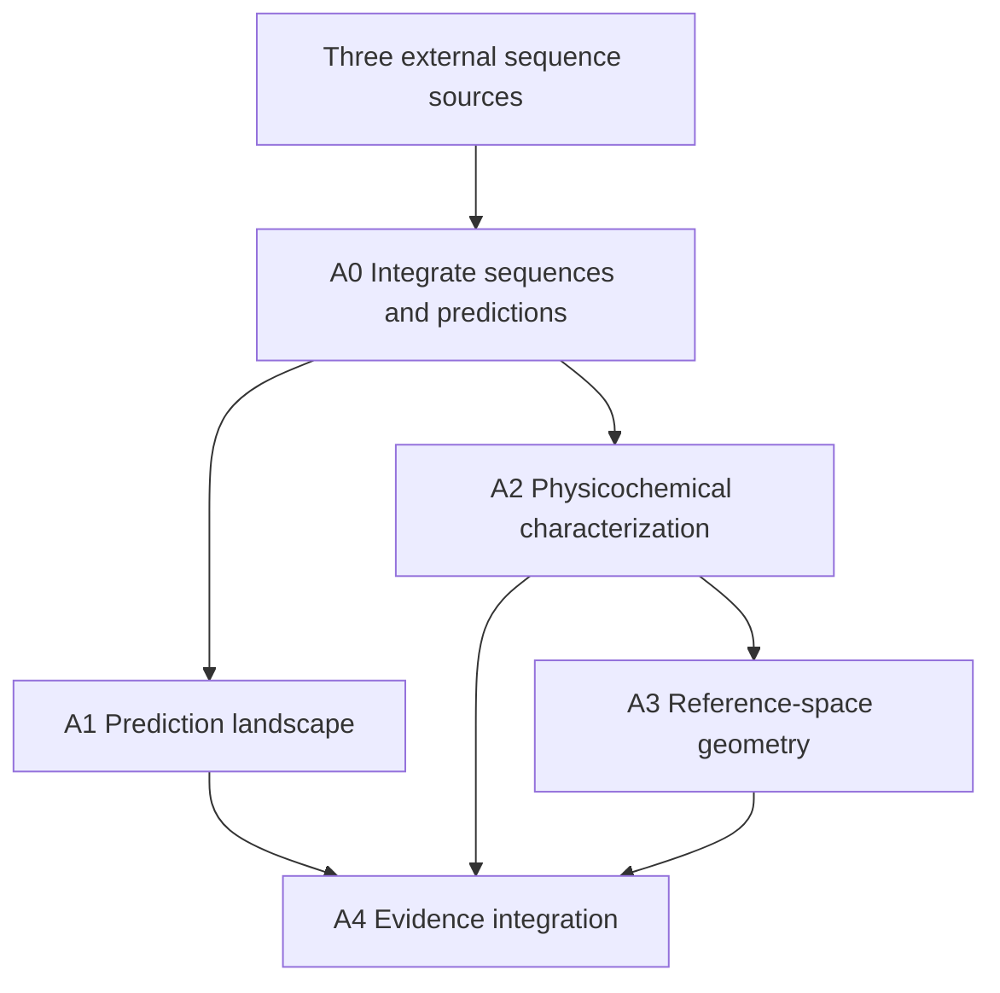

# External Sequence Applications

**PhageLysClass | Frozen predictions, physicochemical support and reference-space geometry**

This part of the work demonstrates how the pretrained predictor can be applied to sequence collections outside the core benchmarking presentation. The analyses remain *computational and descriptive*: they compare predictions with annotated references, without claiming that enzyme activity has been experimentally demonstrated.

## 1. Three sequence sources

| Source | Biological motivation | Files retained under `examples/` |
| --- | --- | --- |
| **PhageLysData prediction extension (H30)** | Explore previously uncharacterized or prediction-extension sequences after a homology-redundancy reduction | `phagelys_prediction_extension/05_phagelys_prediction_extension_H30_representatives.fasta`, corresponding TSV and summary |
| **ZymCTRL generated panel** | Examine enzyme-conditioned sequence generation in catalytic EC space | `zymctrl_generated/zymctrl_phagelys_10000.fasta`, TSV, configuration, summary and EC panel |
| **Structurally ambiguous phage proteins** | Probe functionally ambiguous structural or adsorption-associated sequences | `ambiguous_structural/ambiguous_structural_qc_pass.fasta` and selected table |

These are **three distinct sources**. Their predictive-class proportions are not directly interchangeable evidence of biological prevalence. In particular, ZymCTRL EC conditioning does not itself distinguish endolysins from virion-associated lytic enzymes; catalytic activity and phage localization are different annotation dimensions.

## 2. Supporting source scripts

The following original preparation and prediction entry points are retained under [`../external_application/`](../external_application/):

| Script | Original responsibility |
| --- | --- |
| `prepare_phagelys_prediction_extension.py` | Extract, QC and deduplicate the prediction extension; apply a fixed BioSieve/MMseqs2 H30 reduction; produce representative sequences and mappings |
| `generate_zymctrl_phagelys_panel.py` | Generate the frozen EC-conditioned panel and its metadata |
| `extract_ambiguous_structural_fasta.py` | Prepare the structurally ambiguous input FASTA |
| `predict_zymctrl_phagelysclass_v2.py` | Apply the frozen model to the generated EC panel |
| `phagelysclass_predict_large_fasta.py` | Run the predictor over larger FASTA inputs |

These scripts document the original upstream preparation. Generating a new dataset or new model predictions is **not required** to inspect this release.

## 3. Post-prediction analyses A0–A4

| Stage | Script | Scientific output |
| --- | --- | --- |
| **A0** | `A0_integrate_external_sources.py` | Unified external-source table, prediction integration, source summaries and QC manifest |
| **A1** | `A1_prediction_landscape.py` | Global and subtype prediction distributions, source-specific panels and descriptive summaries |
| **A2** | `A2_property_characterization.py` | Frozen **26-descriptor** comparisons against annotated training references and per-sequence property support |
| **A3** | `A3_reference_geometry_umap_tsne.py` | Standardized full-descriptor-space nearest-reference and neighborhood coverage; reference-based projections for visualization |
| **A4** | `A4_prediction_geometry_integration.py` | Integrate predicted subtype, property support and geometry-based agreement into an explicit concordance assessment |

**A2** does not select new descriptors or fit the predictive classifier. It uses the 26 already selected physicochemical descriptors to compare external predictions with labeled reference populations; its statistical summaries include distributional effects and multiple-testing control.

**A3** evaluates reference-space proximity in standardized descriptor space. Nearest-neighbor distances and reference-coverage calls are quantitative; **PCA/UMAP/t-SNE projections should not be mistaken for predictive probabilities**. The original workflow uses the reference geometry for interpretation and treats t-SNE as visualization only.

**A4** combines three interpretable support axes: property coverage, empirical geometric coverage and local geometric agreement with the predicted subtype. The resulting `concordant`, `mixed` and `discordant` labels are **operational support summaries**, not calibrated probabilities, independent activity labels or a newly trained classifier.

## 4. Practical use and release portability

For ordinary inference on one of the included FASTA collections, use the public [`inference/phagelysclass_predict.py`](../inference/phagelysclass_predict.py) and the frozen model bundle, following [Model and inference](MODEL_AND_INFERENCE.md).

The A0–A4 research scripts are preserved as source code. Their *original default paths* target the development layout (`using_model/`, `analysis_explored_seqs/`, and selected training-reference tables). Because the compact `release_repo` groups sample FASTAs under `examples/` and excludes most original materialized results, **the A0–A4 chain is not advertised as immediately executable from the new folder alone**. It requires the historical input predictions, mappings and training-reference artifacts, with paths configured as appropriate. This distinction is deliberate; no scientific result was reconstructed during documentation.

A selected application multipanel is included under [`../figures/`](../figures/). The publication-oriented panel builder notebook is also preserved in `external_application/`. These files are an accessible view of the prior analysis, not newly generated evidence.

## 5. Reading the outputs conservatively

1. **A high lytic score** reflects compatibility with the frozen sequence classifier, not measured lytic activity.
2. **A subtype assignment** is conditional on a positive global decision and on the model's functional training evidence.
3. **Property and geometric agreement** helps characterize how close a predicted sequence appears to known annotated sequences, but cannot validate its mechanism experimentally.
4. **A discordant characterization** is a useful diagnostic for further study, not a definitive rejection of a sequence.

For the benchmarking context behind the reference populations, see [Benchmarking and analysis](BENCHMARKING_AND_ANALYSIS.md).
