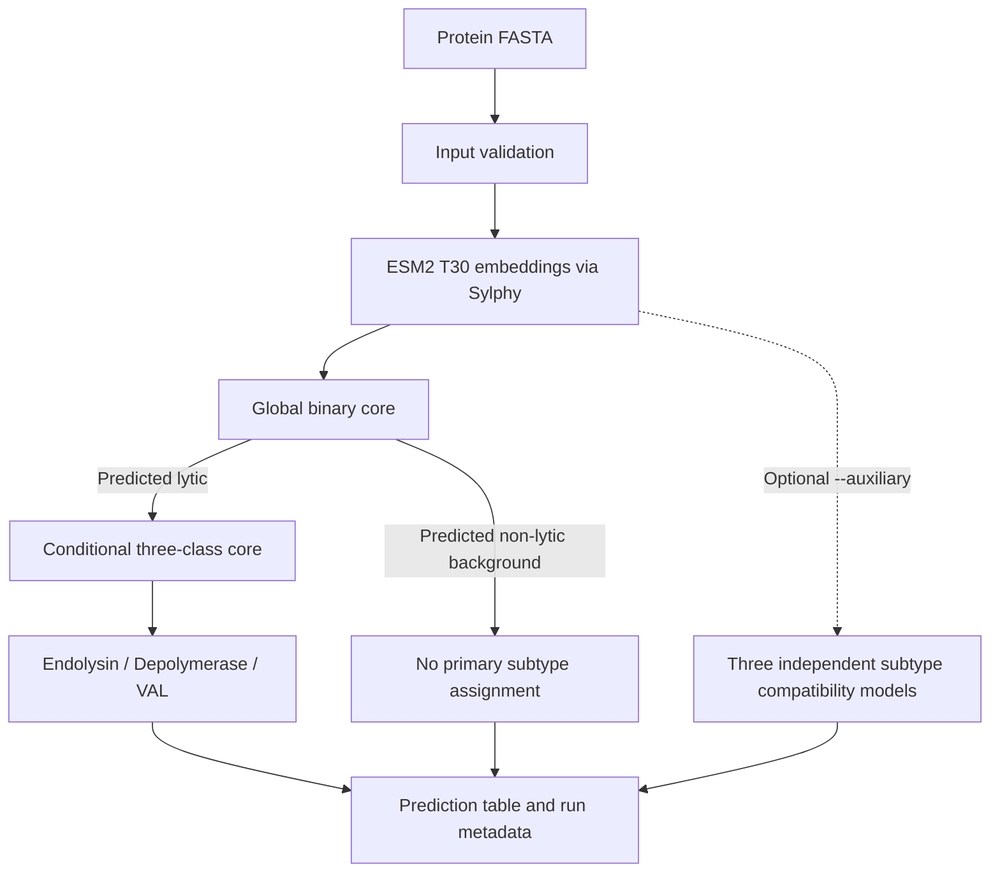

# Model and Inference

**PhageLysClass v1 | Frozen production architecture and FASTA interface**

The user-facing inference entry point is [`../inference/phagelysclass_predict.py`](../inference/phagelysclass_predict.py). It loads the **already fitted** production bundle in [`../models/phagelysclass_v1/`](../models/phagelysclass_v1/) and generates predictions from protein sequences. Inference does not require rerunning the benchmark or retraining the estimators.

## 1. Architecture



| Component | Release task | Frozen estimator recipe | Output meaning |
| --- | --- | --- | --- |
| Global core | `global_mixed` | KNN + MLP | Global lytic compatibility |
| Functional core | `multiclass_clean` | XGB + LR | Endolysin / Depolymerase / VAL distribution *conditional on predicted lytic state* |
| Endolysin auxiliary | `subtype_endolysin` | KNN + XGB + MLP | Independent subtype compatibility |
| Depolymerase auxiliary | `subtype_depolymerase` | MLP + KNN | Independent subtype compatibility |
| VAL auxiliary | `subtype_val` | MLP | Independent subtype compatibility |

The bundle declares **five components and ten fitted estimators**. The two core components use unweighted mean probability voting across their members; auxiliary models are optional diagnostic outputs and do not override the primary hierarchy. The exported manifest also records the validation-only configuration-consolidation rule, fitted-task evidence, software metadata and SHA-256 artifact references.

## 2. Frozen representation

| Property | Value |
| --- | --- |
| Protein language model | `facebook/esm2_t30_150M_UR50D` |
| Runtime interface | Sylphy embedding backend |
| Aggregation | Final/last hidden representation, mean sequence pooling |
| Precision | FP32 |
| Dimension | 640 per sequence |
| Maximum input length | 1,024 residues |
| Supported alphabet | 20 canonical amino acids |

This is the representation required by the shipped estimators. Do **not** substitute another ESM2 size, pooling strategy, layer or numerical precision and assume that the model predictions remain comparable.

## 3. Example command

The following illustrates the existing CLI; it is reproduced from the source interface and **was not executed during documentation preparation**.

```bash
python inference/phagelysclass_predict.py \
  --input examples/known_positive_depolymerase_demo.fasta \
  --models models/phagelysclass_v1 \
  --output example_predictions.tsv \
  --auxiliary
```

| Argument | Function |
| --- | --- |
| `--input` | FASTA containing one or more protein sequences |
| `--models` | Directory containing the frozen `phagelysclass_v1` manifest and task artifacts |
| `--output` | Prediction table, ending in `.tsv` or `.csv` |
| `--auxiliary` | Include all three subtype compatibility scores |
| `--device` | `auto`, `cpu` or `cuda` (optional) |
| `--batch-size` | Sylphy embedding batch size (optional; default 16) |
| `--metadata-output` | Override the run-metadata JSON path |

The script writes an additional sidecar JSON by default at `<output>.metadata.json`, recording the model and embedding configuration, input validity counts and execution metadata. The release retains the original `inference/README.md` as a shorter operational reference.

## 4. Interpreting predictions

**First decision — global recognition.** The primary output is `global_score`, evaluated against the frozen threshold **0.5**. It yields `global_prediction = lytic` or `non_lytic_background`.

**Second decision — conditional function.** If the global result is lytic, the multiclass core reports `p_endolysin_given_lytic`, `p_depolymerase_given_lytic` and `p_val_given_lytic`, and emits `functional_prediction`. If the global result is non-lytic background, these conditional probabilities are **NA** and the primary functional prediction is not reported.

**Optional diagnostics.** With `--auxiliary`, the table adds `endolysin_compatibility_score`, `depolymerase_compatibility_score` and `val_compatibility_score`. These are separate binary compatibility assessments, **not** calibrated biological activity probabilities and **not** substitutes for the core hierarchy.

**Warnings and input status.** Empty, noncanonical or overlength sequences are marked invalid and do not receive valid predictions; repeated FASTA identifiers are rejected. A globally lytic prediction assigned to VAL carries `VAL_evidence_limited`, reflecting the limited evidence for this subtype.

## 5. Files in the production bundle

```text
models/phagelysclass_v1/
├── manifest.json
├── checksums.tsv
├── representation/
│   └── esm2_t30_150m.json
└── tasks/
    ├── global_mixed/
    ├── multiclass_clean/
    ├── subtype_endolysin/
    ├── subtype_depolymerase/
    └── subtype_val/
```

Each task contains its metadata, serialized fitted `members/*.joblib` and (where applicable) `ensemble.json`; performance summaries are also included. Some KNN artifacts exceed ordinary GitHub file limits. The Drive release folder preserves them, but the eventual GitHub/Zenodo distribution needs an appropriate artifact-hosting strategy.

`manifest.json` preserves **original absolute source paths** for provenance. These are historical references to the construction environment, not user-facing input paths. For inference, point `--models` to the portable bundle directory as shown above.

## 6. Important limitations

- The included five positive-control Depolymerase sequences were drawn from the project evidence universe. They are a **qualitative interface example**, not independent external validation.
- The output describes *sequence-based model compatibility*, not measured enzyme activity, antibacterial efficacy, host specificity, safety or experimental developability.
- Serialized `.joblib` files should be loaded only from trusted releases. Use the recorded manifest/checksums as part of normal artifact handling.
- Reproducing the *training* benchmark requires the original data and result trees. Running *inference* requires the frozen model files, a compatible software environment and the Sylphy ESM2 model download/cache.
- Environment installation and dependency pinning belong to the next release-preparation stage; do not treat this guide as a completed environment lockfile.
