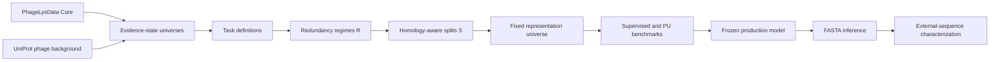

# PhageLysClass Documentation

> **From curated biological evidence to reproducible classification of phage lytic enzymes.**
>
> This documentation describes the *released source code and frozen model artifacts*. It is a reading and reuse guide, not a request to rerun the experiments.

## Start here

| I want to… | Read | What I will find |
| --- | --- | --- |
| Understand the research workflow | [Scientific workflow](WORKFLOW.md) | Data provenance, task construction, redundancy, homology, representations and training |
| Examine the benchmarking strategy | [Benchmarking and analysis](BENCHMARKING_AND_ANALYSIS.md) | Factorial R × S design, supervised/PU protocols and notebook map |
| Use the trained predictor | [Model and inference](MODEL_AND_INFERENCE.md) | Frozen architecture, a FASTA example, score interpretation and input requirements |
| Understand the external applications | [External applications](EXTERNAL_APPLICATIONS.md) | ZymCTRL, prediction-extension and structurally ambiguous proteins; A0–A4 analyses |
| Explore the original detailed methodology | [Methodology references](#original-methodology-references) | Detailed design documents preserved from development |

## The system at a glance

The project treats **P** (curated positive evidence), **N** (evidence-defined candidate negatives) and **U** (unlabeled proteins) as different scientific states. Missing lytic annotation does not, by itself, establish a biological negative. The pipeline evaluates both representation choice and the effect of sequence redundancy and homology-aware splitting.

## Repository navigation

| Location | Purpose |
| --- | --- |
| [`../src/`](../src/) | Original numbered processing, representation, splitting, training and aggregation scripts |
| [`../config/`](../config/) | Evidence rules, UniProt queries and representation registry |
| [`../runs/`](../runs/) | Original shell scripts for the factorial training runs |
| [`../notebooks/`](../notebooks/) | Selected research-question notebooks and production-model export/characterization |
| [`../eda/`](../eda/) | E0–E6 exploratory characterization notebooks and final panel builder |
| [`../external_application/`](../external_application/) | A0–A4 application analyses and supporting prediction/preparation scripts |
| [`../inference/`](../inference/) | Public-facing FASTA prediction entry point and its original README |
| [`../models/phagelysclass_v1/`](../models/phagelysclass_v1/) | Frozen estimators, task recipes, manifest, checksums and representation specification |
| [`../examples/`](../examples/) | Positive-control and selected external-sequence examples |
| [`../figures/`](../figures/) | Selected manuscript and supplementary figure assets |

## Three ways to use the release

**Use the predictor.** Start with [Model and inference](MODEL_AND_INFERENCE.md). The supplied positive-control FASTA is intended to illustrate the interface, not to estimate out-of-sample performance.

**Understand the study.** Follow [Scientific workflow](WORKFLOW.md) and [Benchmarking and analysis](BENCHMARKING_AND_ANALYSIS.md). These documents explain the preserved code and experiments without reproducing the entire manuscript.

**Inspect applications.** Follow [External applications](EXTERNAL_APPLICATIONS.md) to understand the post-prediction physicochemical and geometric analyses. These are interpretation and consistency analyses, not experimental validation of enzymatic activity.

## Original methodology references

The documents below were retained deliberately. The new guides provide the overview; these originals contain the fuller scientific rationale and methodological decisions.

- [Data collection and evidence-state construction](PhageLysClass_Stages01-04_Data_Collection_Methods.md)
- [Task definition methodology](PhageLysClass_Task_Definition_Methodology.md)
- [Redundancy reduction methodology](PhageLysClass_Stage07_Redundancy_Methodology.md)
- [Predictive training and factorial analysis design](PhageLysClass_Training_Methodological_Design_v2.md)

## Release scope and important limits

This is a **code-and-model release**. Large raw/processed datasets, complete embedding matrices, factorial result trees and historical notebook caches were intentionally not copied into `release_repo`. Consequently, some source scripts and research notebooks reference data and result paths from the original working repository. Their presence documents the methods; it does **not** imply that the full benchmark can be replayed from this compact release alone.

All experiments and prediction examples referenced here predate this documentation. **No models, embeddings, metrics or figures were regenerated to write these guides.** The software environment will be documented separately in the environment-preparation stage.
